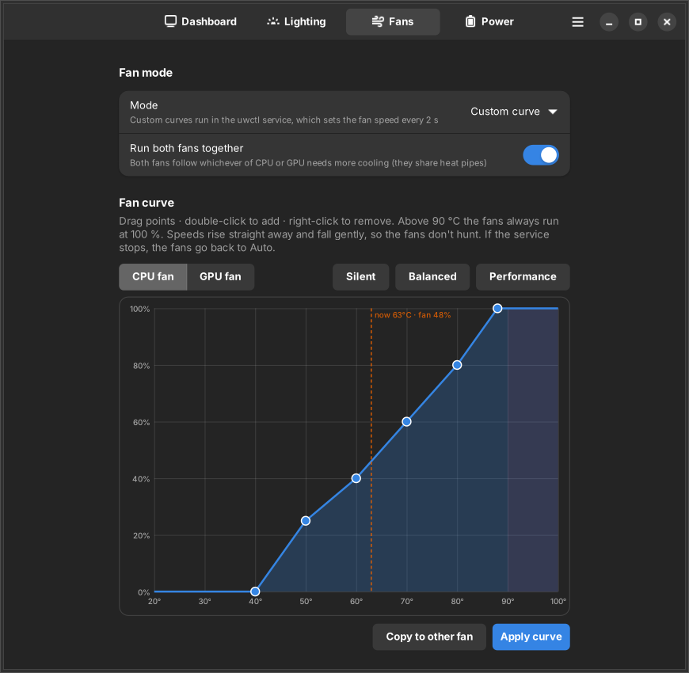
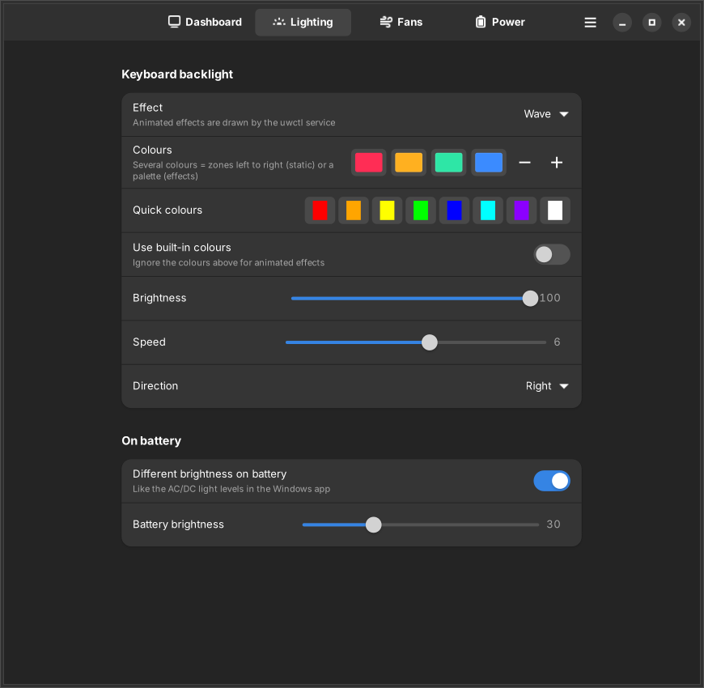
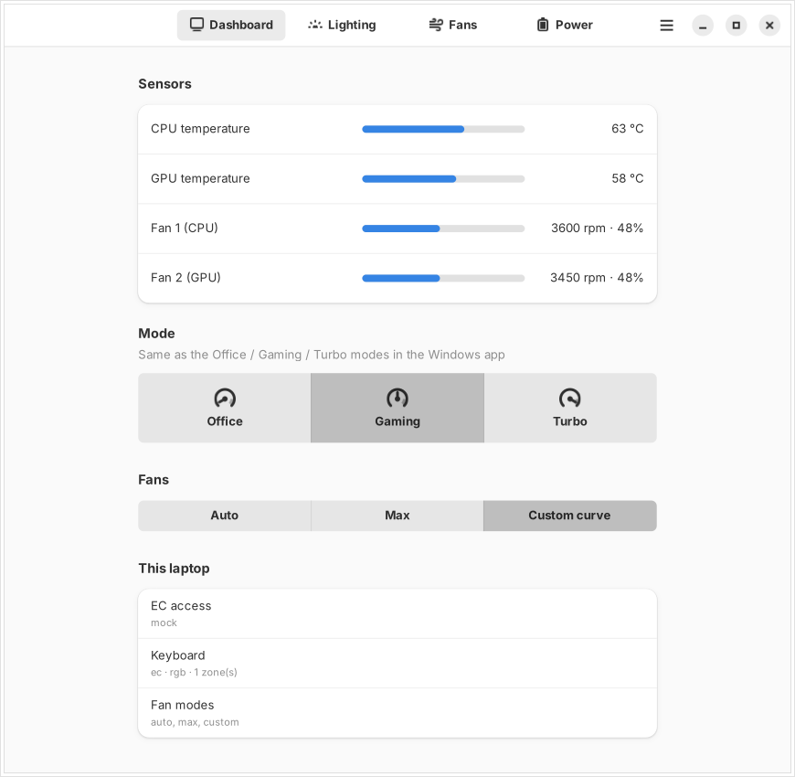
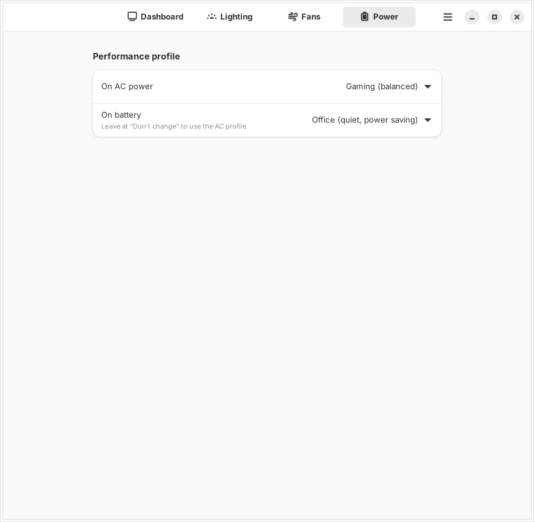

# uwctl: a Linux control centre for Uniwill / Tongfang gaming laptops

Keyboard lighting, fan curves and performance modes for the many gaming laptops
built by **Uniwill** and **Tongfang** and sold under other brand names. It
replaces the Windows **"GamingCenterU" / Control Center** app that these
laptops ship with, and it runs on **Arch** and **Debian/Ubuntu**-based
distributions.

<p align="center">
  
  
</p>
<p align="center">
  
  
</p>
<p align="center"><sub>Screenshots use a simulated laptop, so the readings are made up.</sub></p>

> [!NOTE]
> **This project was built with AI.** uwctl was written by Claude, Anthropic's
> AI model, in a conversation with [Ray](#about-this-project), who tested it on
> his own laptop. See [About this project](#about-this-project) for how it was
> made and what that means for you.

## Features

| | |
|---|---|
| **Keyboard lighting** | Colour, brightness, effects: breathing, flash, wave, rainbow wave, spectrum cycle, random, scan, snake. Single-zone, multi-zone and per-key keyboards. Separate brightness on battery. |
| **Fans** | Auto, Max, and **custom fan curves** for the CPU and GPU fans, with a drag-and-drop curve editor. |
| **Performance modes** | Office / Gaming / Turbo, like the Windows app. Optionally a different mode on battery. |
| **Lightbar** | Colour, on/off and rainbow, on models that have one. |
| **Extras** | Battery charge limit, Fn lock and Win-key lock, when the kernel's `uniwill-laptop` driver is loaded (Linux 6.19+). |
| **Survives reboots and suspend** | Settings are re-applied at boot, after resume and when you plug in or unplug. |
| **Three ways to use it** | A GTK 4 app, the `uwctl` command line tool, and a JSON socket API for scripts. |

## Tested hardware

| Laptop | Board | Setup | Status |
|---|---|---|---|
| Tongfang GK5 (Intel 10th gen, RTX 2060), sold as "NBINF-O5-10R6" | `GK5MR0O` | Arch Linux, kernel 7.3, KDE Plasma | ✅ Keyboard colour, brightness and effects · ✅ Auto, Max and custom fan curve · ✅ App and CLI |

The same chassis is sold as the XMG Core 15, Maingear Vector 2, Gateway Creator,
CyberPowerPC Tracer IV Slim and Illegear Onyx V. Other Uniwill and Tongfang
models should work too. **Please [send a hardware report](../../issues/new/choose)**
with the output of `uwctl doctor`, whether things work or not. That's how
support grows.

Performance profiles write the same register values as TUXEDO's driver, but
their effect hasn't been measured on the GK5 yet.

## Install

### Arch Linux and derivatives

Download `uwctl-<version>.tar.gz` from the [latest release](../../releases/latest)
(or clone this repository), then:

```sh
tar xf uwctl-*.tar.gz && cd uwctl-*/
./install.sh
```

The installer picks the right `acpi_call` package for your kernel: `acpi_call`
for `linux`, `acpi_call-lts` for `linux-lts`, otherwise `acpi_call-dkms` with
headers. It then installs uwctl and starts the `uwctld` service.

Prefer a package? Run `make dist`, copy `packaging/arch/*` next to the tarball
in `dist/`, and run `makepkg -si` there.

### Debian, Ubuntu, Mint, Pop!_OS

Download the `.deb` from the [latest release](../../releases/latest), then:

```sh
sudo apt install ./uwctl_*_all.deb
```

It pulls in `acpi-call-dkms`, which needs headers for your running kernel
(`linux-headers-amd64` on Debian, `linux-headers-generic` on Ubuntu). The
`./install.sh` route above works here too.

### Then

```sh
uwctl doctor
```

This shows what was detected and gives tips for anything missing. Open
**Uniwill Control Center** from your app menu. Whoever is logged in at the
laptop can use it straight away; no group or re-login is needed.

> [!IMPORTANT]
> **Secure Boot:** `acpi_call` is an out-of-tree kernel module, so with Secure
> Boot on it must be signed. Debian and Ubuntu ask you to enrol a MOK key on
> first install. If `uwctl doctor` reports `acpi_call: False`, check
> `dmesg | grep acpi_call`.

## Usage

```sh
uwctl status                                   # temperatures, fans, current settings
uwctl monitor                                  # live view

uwctl kbd color cyan                           # whole keyboard
uwctl kbd color red orange green blue          # zones, left to right
uwctl kbd effect wave -c '#ff2d55' -s 7 -d left
uwctl kbd effect rainbow
uwctl kbd brightness 60 --battery 20           # dimmer on battery
uwctl kbd off

uwctl fan auto | max
uwctl fan custom --preset balanced             # silent | balanced | performance
uwctl fan custom --cpu '40:0,55:30,65:45,75:70,85:100' --gpu '45:0,60:35,75:70,85:100'
uwctl fan show

uwctl profile gaming --battery office          # Office / Gaming / Turbo
uwctl lightbar on -c '#00ffff'
uwctl battery 80                               # needs the uniwill-laptop kernel driver
uwctl winkey off                               # needs the uniwill-laptop kernel driver
```

Settings live in `/etc/uwctl/state.json`. `uwctl-gui --demo` and
`uwctl --dry-run …` run against a simulated laptop, so you can try everything
without touching hardware.

## Fan curves and safety

How a custom curve runs depends on the embedded controller (EC), the chip
that runs the fans and keyboard lights:

- **Hardware curve:** newer ECs store a 16-step temperature→speed table for
  each fan. uwctl writes your curve into it, and the EC follows it on its own.
- **Software curve:** older ECs, such as the 2020 Tongfang GK5, have no such
  table. The `uwctl` service sets the fan speed every 2 seconds instead. Speeds
  rise immediately and fall gently, so the fans don't hunt.

Safety, whichever way the curve runs:

- Every curve is forced to **100 % at 90 °C and above**.
- **Failsafe:** at 95 °C CPU or 92 °C GPU, the fans go to maximum until things
  cool down. If the temperature can't be read, they also run at full speed.
- **If the service stops or crashes during a software curve, the fans go
  straight back to the firmware's Auto mode**, so they're never left stuck at a
  low speed.
- uwctl only writes EC registers on a short, fixed allowlist. Everything else is
  refused in code.
- `uwctl fan auto` hands the fans back to the firmware at any time.

## How it works

The Windows app talks to the EC through a small ACPI driver. uwctl calls the
same firmware methods from Linux through the `acpi_call` kernel module:

- `ECRR` / `ECRW` on the `INOU0000` ACPI device on newer models
- the WMI method `GetSetULong` on older ones

Per-key keyboards with the ITE 829x controller (USB `048d:8910`) are driven
directly over hidraw, and keyboards exposed by a kernel driver go through the
standard LED interface.

The full technical write-up is in **[docs/how-it-works.md](docs/how-it-works.md)**:
register map, protocols, fan algorithm and access control.

## Troubleshooting

| Problem | What to do |
|---|---|
| `inou0000: None` **and** `wmi_ec_method: None` in `uwctl doctor` | The laptop doesn't expose a Uniwill EC interface, so it probably isn't a Uniwill/Tongfang machine. |
| `acpi_call: False` | Install `acpi_call` (Arch), `acpi_call-lts` or `acpi_call-dkms` for other kernels, or `acpi-call-dkms` (Debian/Ubuntu). Then run `sudo modprobe acpi_call`. See the Secure Boot note above. |
| `permission denied on the uwctld socket` | Local users get access within 5 seconds of logging in. Over SSH, add yourself to the `uwctl` group. |
| Brightness has fewer steps than expected | EC keyboards have 3 or 5 levels. Set `"ec_levels": 2` in `/etc/uwctl/state.json` for 3-level keyboards. |
| Fans behave oddly | Run `uwctl fan auto`, then open an issue with `uwctl doctor`, `uwctl fan show` and `journalctl -u uwctld -b`. |
| You also run TUXEDO Control Center | Don't run both. `uwctld` stops `tccd` when it starts. |

## Uninstall

```sh
./uninstall.sh            # or: sudo pacman -R uwctl  /  sudo apt remove uwctl
```

The fans are handed back to the firmware first. Add `--purge` to delete saved
settings.

## About this project

uwctl started when Ray wanted the Windows control centre for his Tongfang
laptop to work on Linux. It was written by **Claude** (Anthropic's AI model)
in one long conversation. Ray tested every step on his own hardware and
reported back, and that loop is how the WMI support and the software fan curve
came about.

What that means in practice:

- **No vendor code.** The Windows app's code is obfuscated and was not
  decompiled. Its installer was only checked for driver manifests and device IDs.
  Everything uwctl knows about the hardware comes from open-source Linux
  drivers: the upstream kernel `uniwill-laptop` driver, TUXEDO's
  `tuxedo-drivers`, and OpenRGB's ITE 829x controller.
- **Tested, but on one laptop.** The code has 68 unit tests against a
  simulated EC and a fake `/sys`, and has run on the hardware listed above.
  Other models are untested until someone reports back.
- **Read it before you trust it.** It's about 4,000 lines of plain Python with
  no compiled parts. [docs/how-it-works.md](docs/how-it-works.md) explains every
  register it touches.

Contributions, hardware reports and bug fixes are welcome. See
[CONTRIBUTING.md](CONTRIBUTING.md).

### Credits

- The Linux **`uniwill-laptop`** driver (Armin Wolf, with TUXEDO Computers)
  documents the `INOU0000` and WMI interfaces and the EC registers.
- TUXEDO Computers' **`tuxedo-drivers`** provided the fan-table and direct
  fan-control techniques.
- **OpenRGB** provided the ITE 829x keyboard protocol.
- **`acpi_call`** lets Linux call these firmware methods.

uwctl is not affiliated with Uniwill, Tongfang, TUXEDO or any laptop brand.

## License

GPL-2.0-or-later. See [LICENSE](LICENSE).

**No warranty.** uwctl writes to your laptop's embedded controller. It does
that carefully, but it's your hardware and your call.
