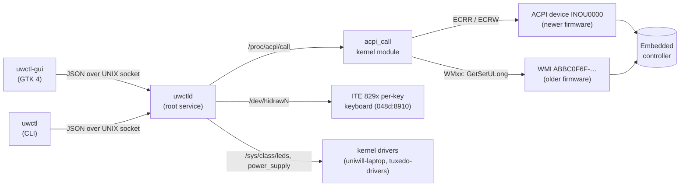

# How uwctl works

This page is for people who want to know exactly what uwctl does to their
laptop, or who want to add support for another model.

## Components



* **`uwctld`** (`src/uwctl/daemon.py`) is the only process that touches
  hardware. It applies saved settings at boot, after resume and on AC/battery
  changes. It runs software keyboard effects and software fan curves, and it
  serves a small JSON API.
* **`uwctl`** (`cli.py`) and **`uwctl-gui`** (`gui/`) are unprivileged clients.
* **`controller.py`** maps settings (`/etc/uwctl/state.json`, validated by
  `state.py`) onto the hardware backends.

## Reaching the embedded controller

Uniwill firmware offers two ways to read and write the EC's RAM.

### 1. `INOU0000` ACPI device (newer firmware)

This is the device the Windows `ACPIDriver.sys` binds to. Its ACPI methods are
`ECRR(addr)`, which returns a byte, and `ECRW(addr, value)`, which writes one.
Addresses go up to `0xFFF`. uwctl finds the device's ACPI path in
`/sys/bus/acpi/devices/INOU0000:*/path` and calls, for example:

```
\_SB_.INOU.ECRR 0x43e            → 0x38
\_SB_.INOU.ECRW 0x769 0x20
```

### 2. WMI `GetSetULong` (older firmware, e.g. Tongfang GK5)

The WMI GUID is `ABBC0F6F-8EA1-11D1-00A0-C90629100000`, method id 4. uwctl reads
the block's `object_id` (for example `BC`) and its parent `PNP0C14` device's ACPI
path from sysfs, giving the ACPI method that implements it (for example
`\_SB_.AMW0.WMBC`). The arguments are `instance=0`, `method=4`, and an 8-byte
buffer:

| byte | 0 | 1 | 2 | 3 | 4 | 5 | 6 | 7 |
|---|---|---|---|---|---|---|---|---|
| | addr lo | addr hi | data lo | data hi | 0 | **op**: 1 = read, 0 = write | 0 | 0 |

```
\_SB_.AMW0.WMBC 0x0 0x4 b3e04000000010000   → {0x38, 0x00, 0x00, 0x00}
```

The first byte of the reply is the value. `0xFEFEFEFE` means the EC didn't
answer; uwctl retries twice. This route reaches 16-bit addresses, including the
direct fan registers at `0x1804`/`0x1809`.

Both routes wait 6 ms after every access, as the Windows app and the kernel
driver do, so the EC isn't flooded.

### Write allowlist

`ec.py` refuses to write any register that isn't in `constants.WRITABLE`:

| Registers | Purpose |
|---|---|
| `0x0751` | fan mode / performance profile bits |
| `0x0767`, `0x0769`–`0x076B`, `0x078C` | keyboard colour, apply trigger, brightness |
| `0x0748`–`0x074B`, `0x07E2`–`0x07E5` | lightbar (AC and battery) |
| `0x07C5`, `0x07C6` | enable custom fan tables |
| `0x0F00`–`0x0F5F` | custom fan tables (hardware curves) |
| `0x1804`, `0x1809` | direct fan duty (software curves, WMI only) |

### Registers read

| Register | Meaning |
|---|---|
| `0x043E` / `0x044F` | CPU / GPU temperature (°C) |
| `0x0464–65` / `0x046C–6D` | fan 1 / fan 2 RPM (big-endian) |
| `0x075B` / `0x075C` | current fan duty (0–200) |
| `0x0740` | project ID (`0x0F` = Comet Lake gaming) |
| `0x0765`, `0x0766` | feature bits (lightbar, fan boost, RGB keyboard) |
| `0x078C` bit 0 | white-only keyboard |
| `0x078E` bit 6 | EC has universal fan control (hardware curves) |

## Fans

| Mode | What uwctl does |
|---|---|
| Auto | clears full fan mode (`0x0751` bit 6) and the custom-table enables |
| Max | sets full fan mode; on WMI machines also writes 200 to the direct duty registers |
| Custom, **hardware** | builds a 16-zone `start temp / end temp / duty` table per fan, writes it to `0x0F00`–`0x0F5F`, then enables split tables (`0x07C5` bit 7) and custom tables (`0x07C6` bit 2) |
| Custom, **software** | sets full fan mode, then writes the duty to `0x1804`/`0x1809` every 2 s |

**Curve rules (`fans.py`).** Points are sorted and speeds made non-decreasing,
and every curve reaches 100 % by 90 °C. Speeds below 12.5 % become off, and
speeds from 12.5 to 25 % become 25 %. Hardware tables are built conservatively:
each zone uses the curve's value at its hot end, so the fan is never slower
than the curve. Duty 0 is written as 1 on hardware tables, because 0 makes the
EC spin the fan at 30 % for three minutes first.

**Software curve (`controller.SoftwareFan`).**

- The fans speed up immediately when the curve asks for more.
- They slow down only once the curve, evaluated 3 °C higher, still asks for
  less. Then they drop by at most 5 % per tick.
- With "both fans together" (the default), both run at the higher of the CPU
  and GPU demands, because the heat pipes are shared.
- A dGPU temperature of 0 (powered down) means the GPU fan follows the CPU.
- Full fan mode is re-engaged every 50 minutes (the EC drops it otherwise, as
  TUXEDO's driver notes), after resume, and if the Fn fan key turns it off.
- When the daemon stops, `release_fans()` returns the fans to Auto. Systemd's
  `ExecStopPost=uwctld --release-fans` does the same after a crash.

**Failsafe.** At 95 °C CPU or 92 °C GPU with a custom curve, the fans go to
maximum until both temperatures are below 78 °C.

## Keyboard backends (`keyboard.py`)

Tried in order: ITE 829x, then the kernel LED class, then the EC.

**EC single-zone.** Colour goes in `0x0769`–`0x076B` (0–50 per channel); then
`0x0767` bit 5 applies it. Brightness is `0x078C` bits 7–5 plus the apply bit
(bit 4). Writing 0,0,0 makes the EC restore its default colour, so uwctl writes
1,1,1 instead and turns the light off through brightness.

**ITE 829x (USB `048d:8910`).** Commands are 6-byte HID feature reports,
`[0xCC, cmd, d0, d1, d2, d3]`. Each LED id is `(row << 5) | col` on a 6 × 20
grid.

| Command | Bytes |
|---|---|
| set key colour | `CC 01 id R G B` |
| brightness / speed | `CC 09 brightness(0–10) speed(0–10)` |
| clear | `CC 00 0C` |
| animations | `CC 00 02` spectrum · `04` wave · `09` random · `0A` scan · `0B` snake |
| breathing / flash | `CC 0A AA R G B` / `CC 0B AA R G B` (no colour = random) |
| wave colour + direction | `CC 15 (A1+dir) R G B`, or `CC 15 (71+dir)` for the rainbow preset |

**LED class.** This covers any `*kbd_backlight*` device from a kernel driver.
uwctl writes `multi_intensity` and `brightness`, and stretches the zones over
however many LEDs the driver creates.

Software effects (breathing, flash, spectrum, wave) are animated by the daemon
on backends without hardware effects.

## Access control

The socket is `/run/uwctl/uwctl.sock`, owned by `root:uwctl` with mode `0660`.
In addition, `access.py` reads logind's session list (`/run/systemd/sessions`)
and adds a POSIX ACL entry for every user with an **active, local** session.
Remote sessions and the login screen don't count. It's the same idea as
systemd's `uaccess` for sound cards, so whoever is at the laptop can use the
app without joining a group or logging in again. The list is refreshed every 5
seconds.

## Socket API

Requests are one JSON object per line, for example `{"cmd": "...", "args": {...}}`.

| Command | Result |
|---|---|
| `ping` | version |
| `capabilities` | what the laptop supports |
| `status` | sensors, fan mode, profile, errors |
| `get_state` | saved settings |
| `set` + `{"state": {...partial...}}` | validate, save and apply |
| `apply` | re-apply everything |
| `doctor` | the diagnostics report |

```sh
echo '{"cmd":"status"}' | socat - UNIX-CONNECT:/run/uwctl/uwctl.sock
```

## Adding a new model

1. Run `uwctl doctor` and attach it to a
   [hardware report](../../../issues/new/choose).
2. If a feature needs a new register, add it to `constants.py`. Add it to
   `WRITABLE` only if it has to be written. Cover it with a `MockEC` test.
3. Never write a register you can't explain. "Randomly poking the EC can
   potentially cause damage to the machine", as the kernel documentation puts
   it.

## Sources

* Linux kernel docs, *Uniwill Notebook driver*:
  <https://docs.kernel.org/wmi/devices/uniwill-laptop.html> and
  <https://docs.kernel.org/admin-guide/laptops/uniwill-laptop.html>
* TUXEDO Computers, *tuxedo-drivers*:
  <https://gitlab.com/tuxedocomputers/development/packages/tuxedo-drivers>
* OpenRGB, ITE 829x controller:
  <https://gitlab.com/CalcProgrammer1/OpenRGB/-/merge_requests/3236>
* acpi_call: <https://github.com/nix-community/acpi_call>
